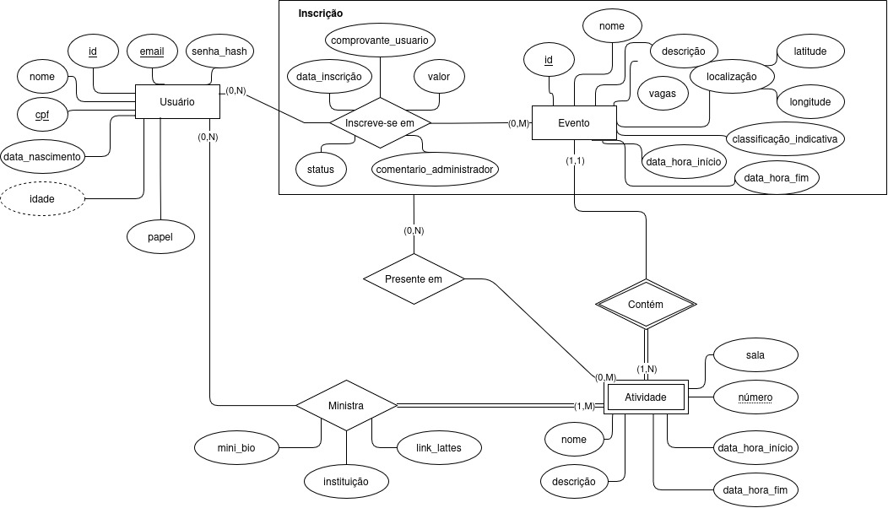

# Trabalho Prático de Fundamentos de Bancos de Dados - 2026.1

## Descrição

Esse repositório contém um sistema de gestão de eventos simples para exemplificar o
trabalho da disciplina de Fundamentos de Bancos de Dados.

Em [./docs/regras-de-negocio.md](./docs/regras-de-negocio.md) estão definidos os requisitos 
funcionais da aplicação.

## Configuração

A conexão com o banco e outras opções da aplicação são definidas através de variáveis de ambiente.
Para o ambiente local, crie um arquivo .env seguindo a estrutura de .env.example.

O valor da variável STORAGE_SECRET pode ser gerado com o seguinte código python
```python
 import secrets
 secrets.token_urlsafe(32)
```

## Etapas

### Diagrama ER
 


O relacionamento entre as entidades foi modelado utilizando a notação EER de Elmasri & Navathe Pelo draw.io.

### Modelo Relacional

A partir do modelo EER, as entidades e relacionamentos foram convertidas para o modelo relacional
que representa as mesmas relações de forma tabular e com chaves primárias e estrangeiras definidas:

```mermaid
erDiagram
    USUARIO {
        int id PK
        string nome
        string cpf
        string email
        string papel
        string sexo
        string estado_civil
        string senha_hash
        date data_nascimento
    }

    EVENTO {
        int id PK
        string nome
        string descricao
        int vagas
        string classificacao_indicativa
        datetime data_hora_inicio
        datetime data_hora_fim
        decimal latitude
        decimal longitude
        float valor
    }

    ATIVIDADE {
        int id_evento PK, FK
        int id PK
        string nome
        string descricao
        string sala
        int vagas
        datetime data_hora_inicio
        datetime data_hora_fim
    }

    INSCRICAO_EVENTO {
        int id_usuario PK, FK
        int id_evento PK, FK
        datetime data_inscricao
        string status
        string comentario_administrador
        string comprovante_usuario BYTEA
        float valor
        boolean meia
    }

    PRESENCA_ATIVIDADE {
        int id_usuario PK, FK
        int id_evento PK, FK
        int id_atividade PK, FK
    }

    MINISTRANTE {
        int id_usuario PK, FK
        int id_evento PK, FK
        int id_atividade PK, FK
        string mini_bio
        string instituicao
        string link_lattes
    }

    USUARIO ||--o{ INSCRICAO_EVENTO : "faz"
    EVENTO ||--o{ INSCRICAO_EVENTO : "recebe"
    EVENTO ||--|{ ATIVIDADE : "contem"
    PRESENCA_ATIVIDADE }o--|| INSCRICAO_EVENTO : "vinculada a"
    ATIVIDADE ||--o{ PRESENCA_ATIVIDADE : "possui"
    USUARIO ||--o{ MINISTRANTE : "ministra"
    ATIVIDADE ||--|{ MINISTRANTE : "Ministrada por"
```

O campo `INSCRICAO_EVENTO.valor` é derivado de `EVENTO.valor`: o usuário
escolhe pagar o valor cheio (`meia = false`) ou a meia-entrada
(`meia = true`, que armazena `EVENTO.valor / 2`). O `comprovante_usuario`
serve como justificativa do pedido de meia-entrada quando `meia` é `true`.

> **Nota:** os scripts em `./scripts` rodam apenas na inicialização de um
> volume vazio do Postgres. Para aplicar mudanças no schema, remova o volume
> e suba o compose novamente: `docker compose down -v && docker compose up -d`.

