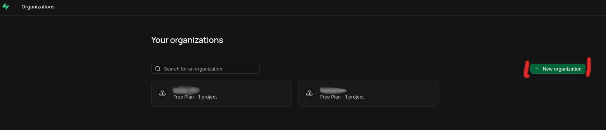
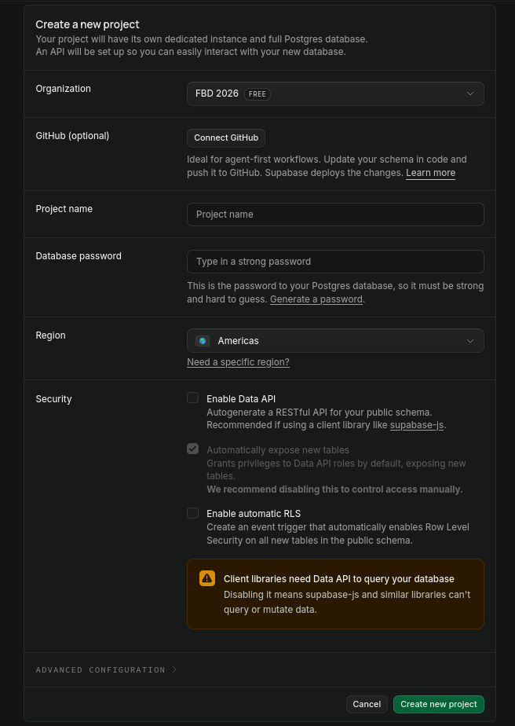
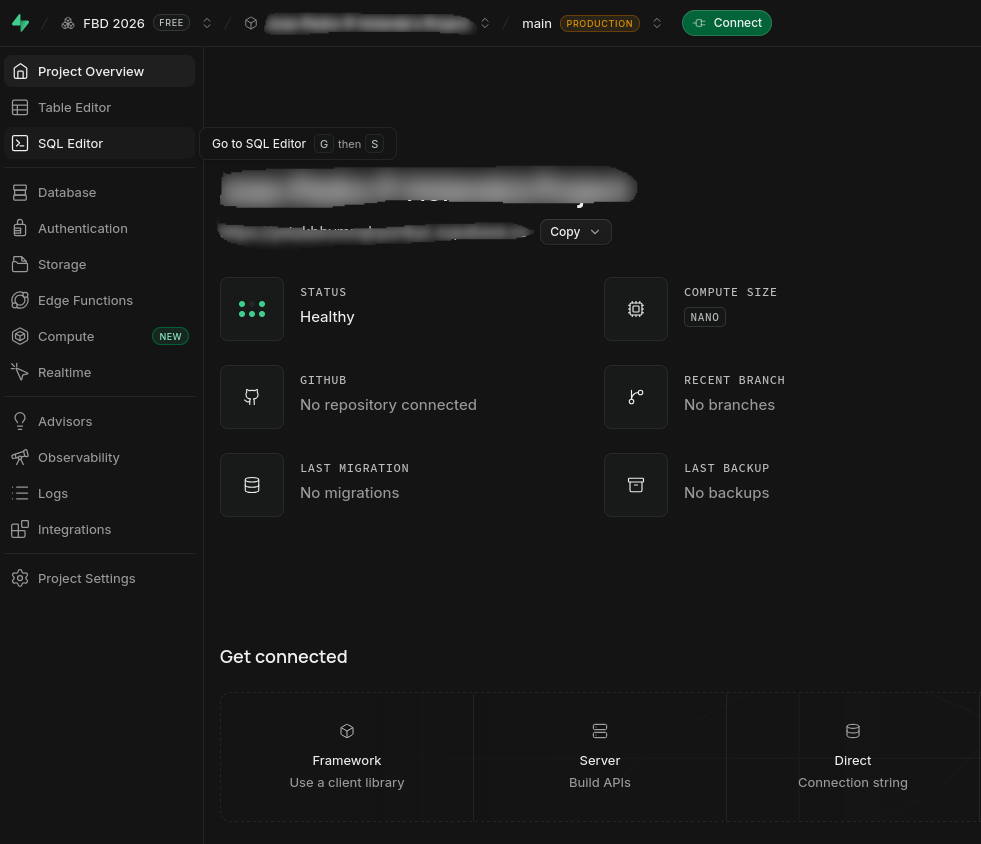
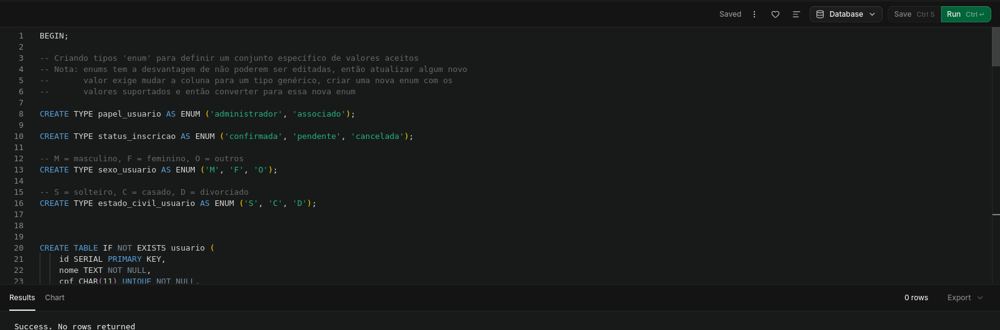
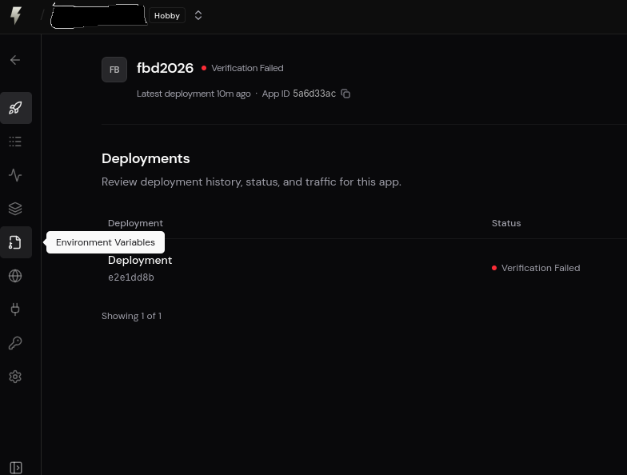
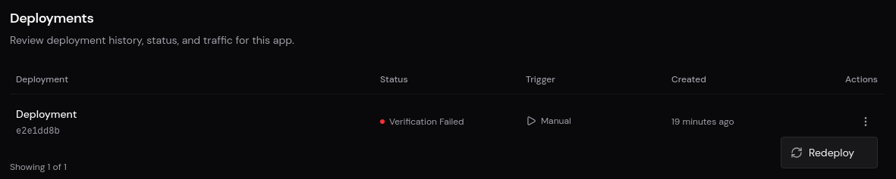
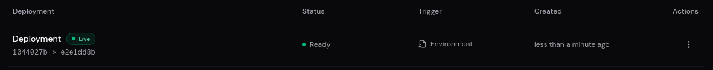

# Subindo o projeto na nuvem


## Banco de Dados

Para criar um novo banco de dados, nós vamos utilizar o Supabase como exemplo.

1. Crie uma conta no Supabase e faça login em [https://supabase.com/dashboard/sign-in](https://supabase.com/dashboard/sign-in?returnTo=%2Forg)

2. Depois de realizar o login, você precisa criar uma organização e um novo projeto, que já inclui um banco Postgres configurado. Navegue para [https://supabase.com/dashboard/organizations](https://supabase.com/dashboard/organizations) e clique em `New organization`, escolha o plano `Free` e confirme em `Create organization`.


3. Após criar a organização, você deve configurar um projeto escolhendo um nome, configurando uma senha e região do projeto. O recomendado é usar a opção "Generate a password" e guardar a senha em um lugar seguro; a região selecionada por padrão também não precisa ser alterada. Também não é necessário habilitar a "Data API" ou "automatic RLS".


4. Depois disso, navegue até a aba `SQL Editor` e execute o script de criação das tabelas.




> Nota: não é recomendado utilizar os scripts de inicialização dos dados em produção, já que todos 
os usuários tem a mesma senha.

### Parâmetros da Conexão

Para saber qual a URL de conexão com o banco clique no botão `connect` na barra superior do projeto, selecione a aba `Direct`, troque de `Direct Connection` para `Session Pooler` e copie a string de conexão começando com `postgresql://...`, depois substitua o texto `[YOUR-PASSWORD]` com a senha do banco que você definiu, use o prefixo `postgresql+psycopg2://` em vez de `postgresql://`. 


## Aplicação

Agora que temos um banco de dados funcional nós podemos subir nossa aplicação e conectar a ele.

Nesse exemplo a aplicação vai ser publicada na plataforma FastAPI Cloud, mas você pode usar outra da sua
preferência, como Vercel ou Render.

### Criando uma conta na FastAPI Cloud

O primeiro passo é se registrar na plataforma em [https://dashboard.fastapicloud.com/signup](https://dashboard.fastapicloud.com/signup).

Depois de criar a conta faça o login localmente com o comando `fastapi login` na raíz desse projeto.

### Subindo a aplicação manualmente

Após fazer o login na CLI do FastAPI, execute o comando `fastapi deploy`.

Essa primeira implantação vai falhar porque as variáveis de ambiente ainda não foram configuradas, no próximo passo veremos como adicioná-las.

> Você também pode utilizar o Github para manter a aplicação sempre sincronizada com a versão mais
recente do Github ([Documentação](https://fastapicloud.com/docs/source-control/github-integration/)).

### Configurando variáveis de ambiente

Navegue para a página do seu app e selecione a aba `Environment Variables`.




- Preencha a variável `DATABASE_URI`  com a URL de conexão do banco obtida anteriormente e ative a opção de secret para ela.
- Utilize uma string aleatória para `STORAGE_SECRET` e também deixe como secret.
- Defina a variável `ENVIRONMENT` com o valor `PRODUCTION`.
- Caso deseje, altere os valores padrão das variáveis opcionais.

Você pode gerar uma string aleatória segura em Python com este código:
```python
 import secrets
 secrets.token_urlsafe(32)
```

Depois de preencher todas as variáveis, clique em `Save and Redeploy`. Caso a aplicação não seja
reiniciada automaticamente, vá para a aba `Deployments` e clique na opção `Redeploy`.



Ao final um deployment com status `live` deve aparecer e o deploy da sua aplicação estará completo


